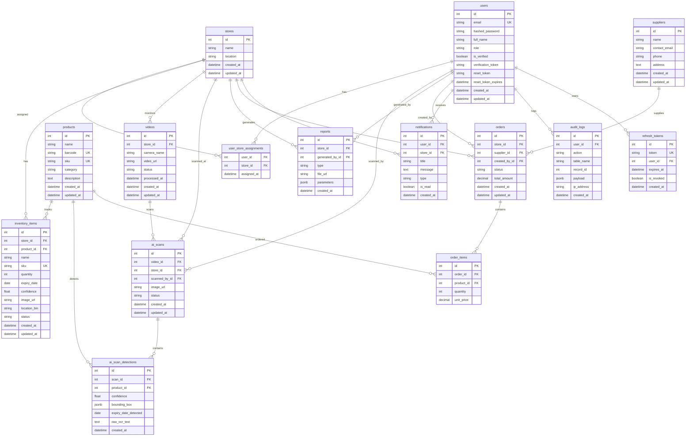

# Grocery Inventory System - Entity Relationship Diagram

This document contains the Entity Relationship (ER) diagram for the system's database schema, modeling 11 normalized tables optimized for millions of records.

